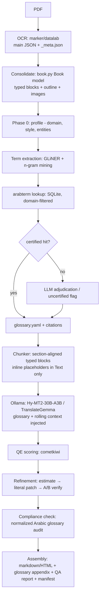

# book-harness

End-to-end pipeline for translating technical books (PDF → Arabic) with a **cited, certified glossary** and **guarded, auditable refinement** — running entirely on local models.

## The problem

Translating a scientific book with an LLM naively produces: inconsistent terminology, destroyed equations and code, lost structure, and no way to verify or resume a 100k+ word job. Professional translation solves this with termbases, QA passes, and provenance — none of which off-the-shelf MT provides.

## The idea

Two phases, both file-backed and resumable:

**Phase 1 — Glossary generation.** Extract terms from the book (GLiNER zero-shot NER + noun-phrase/n-gram mining + LLM adjudication), then look them up in [arabterm](https://github.com/forzagreen/arabterm) — a collection of certified Arabic/English/French dictionaries (KSAA unified glossaries, Librairie du Liban, etc.) shipped as SQLite with full provenance: source dictionary, Wikidata ID, archive.org scan URL, printed page number. Every glossary entry is a **citation**, not a pair. Conflicts are resolved by a deterministic dictionary priority; uncovered terms get an explicit `uncertified` status for human review.

**Phase 2 — Translation.** The book is chunked section-by-section from the OCR structure; each chunk is translated by a dedicated local MT model (Tencent **Hy-MT2-30B-A3B**, or TranslateGemma) with the glossary injected using the model's official terminology template, plus prior-paragraph and rolling-chapter context. Results are cached and resumable. Then a **3-phase guarded refinement** per chunk:

1. **Estimate** — a general instruct model locates ≤12 error spans (MQM-style)
2. **Patch** — pure-Python literal substring replacements, no model
3. **Verify** — a verifier model judges A/B with swapped positions, twice; rejected patches keep the original draft

The model can never rewrite a whole chunk, so errors stay bounded and auditable.

## End-to-end from PDF

The pipeline starts from the output of a marker/datalab OCR run (see [ocr-output-analysis.md](./ocr-output-analysis.md)):



The OCR produces **typed content blocks** (`Text`, `SectionHeader`, `Equation` with LaTeX, `Code`, `Table`, `FigureGroup`, …), a section-hierarchy on every block, and a nested outline tree. This makes most quality decisions structural rather than heuristic:

| Block type | Treatment |
|---|---|
| `Text` | Translate (inline math/links protected inside the block) |
| `SectionHeader` | Translate title; preserve section numbering (`1.4`, `2.3.1`) |
| `ListGroup` | Translate `<li>` items, keep structure |
| `Caption`, `Footnote` | Translate |
| `Equation` | **Passthrough** — LaTeX never reaches the model |
| `Code` | **Passthrough** — fenced listings |
| `Picture` / `Figure` / groups | Passthrough; images extracted to disk; captions translated |
| `Table` / `TableGroup` | Structure passthrough; cell text only |
| `TableOfContents` | Skip or titles only |
| `PageHeader` / `PageFooter` | Dropped (rendering chrome) |

Chunks are **section-aligned** (consecutive content blocks within one outline section, split at paragraph boundaries, keyed by block id) — giving better context, per-chapter glossary scoping, and exact reassembly. Canonical page numbers come from block ids and feed glossary citations ("term first used on p. N") and the QA report.

## Key components

| Role | Choice | Notes |
|---|---|---|
| Translation | `tencent/Hy-MT2-30B-A3B` | MoE (~3B active), 33 languages incl. Arabic, Apache-2.0, official terminology prompt template |
| Translation (light) | `google/translategemma-4b/12b/27b-it` | Gemma3-based, 55 languages |
| Refine / verify | `Qwen/Qwen3.5-27B` or `google/gemma-4-26B-A4B-it` | General instruct model for MQM spans + A/B judging |
| Term extraction | `urchade/gliner_multi-v2.1` | Zero-shot NER, CPU-friendly, custom labels |
| Quality estimation | `Unbabel/wmt22-cometkiwi-da` | Reference-free QE (CC-BY-NC) |
| Terminology DB | `arabterm.db` (SQLite) | AR/EN/FR, Wikidata + archive.org provenance built in |
| OCR / ingest | marker (datalab) + `book.py` | Main JSON + `_meta.json` → `Book` model |

## Design principles

1. **Library first** — the core is a Python package with pure file I/O; CLI, MCP server, and web UI are thin shells over it.
2. **Everything on disk** — every stage writes versioned artifacts; cache key per chunk = `hash(source_chunk + glossary_version + model + prompt_version)`, so changing any input re-runs only affected chunks.
3. **Structural passthrough** — translatability decided by block type; equations, code, images, and table structure never reach a model.
4. **Cited glossary** — every entry carries provenance and a status (`certified | llm_chosen | uncertified`).
5. **Bounded model edits** — the model never rewrites a whole chunk.

## Run artifacts

```text
runs/<book-id>/
  00_source/          OCR JSON pair, consolidated Book model, extracted images
  01_profile/         domain.json, style.md, entities.jsonl
  02_glossary/        candidates.jsonl, glossary.yaml (versioned), audit.md
  03_chunks/          chunk-0001.json (block ids, source, placeholders, hash)
  04_drafts/          chunk-0001.md + .meta.json (model, prompt, glossary ver)
  05_refine/          chunk-0001.spans.json, patches.jsonl, verdicts.jsonl
  06_qa/              qe-scores.jsonl, compliance.jsonl, consistency.jsonl
  07_output/          book.md / book.html, glossary-appendix.md, manifest.json
  state.json          stage cursor for resume
```

## Outputs

- Translated **markdown/HTML** book (structure, equations, code, and images preserved)
- **Glossary appendix** — term, chosen translation, source dictionary, page, Wikidata link
- **Bilingual side-by-side edition** (paragraph-aligned HTML)
- **QA report** per chapter — QE distribution, glossary compliance %, patch counts, uncertified terms
- **Provenance manifest** — per chunk: model, prompt version, glossary version, timestamps
- **TMX export** — aligned pairs as reusable translation memory

## Roadmap

- **M1 — MVP:** OCR JSON in (via `book.py`) → GLiNER + arabterm glossary with citations → Ollama translation of typed content blocks → markdown out.
- **M2 — Accuracy:** refinement loop (estimate/patch/verify) + QE-budgeted scheduling + deterministic compliance audit + model bake-off.
- **M3 — Artifacts:** glossary appendix, bilingual HTML, QA report, provenance manifest, TMX, glossary drift loop.
- **M3.5 — MCP server:** glossary lookup + chunk translation exposed as MCP tools for agent-driven workflows.
- **M4 — Web UI:** SSE progress streaming + human review of `uncertified` terms and low-QE chunks.

See [PLAN.md](./PLAN.md) for the full task-by-task implementation plan.

## Documentation

- [main-idea.md](./main-idea.md) — the original idea and workflow
- [brainstorming.md](./brainstorming.md) — analysis of the idea and implementation directions
- [ocr-output-analysis.md](./ocr-output-analysis.md) — OCR output structure and the `book.py` data model
- [PLAN.md](./PLAN.md) — implementation plan

## Status

🚧 Design phase — implementation starting at M1.