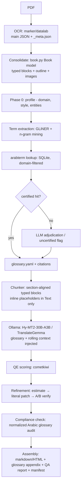

# book-harness

End-to-end pipeline for translating technical books (PDF → Arabic) with a **cited, certified glossary** and **guarded, auditable refinement** — running entirely on local models.

## The problem

Translating a scientific book with an LLM naively produces: inconsistent terminology, destroyed equations and code, lost structure, and no way to verify or resume a 100k+ word job. Professional translation solves this with termbases, QA passes, and provenance — none of which off-the-shelf MT provides.

## The idea

Two phases, both file-backed and resumable:

**Phase 1 — Glossary generation.** Extract terms from the book (GLiNER zero-shot NER + noun-phrase/n-gram mining + LLM adjudication), then look them up in [arabterm](https://github.com/forzagreen/arabterm) — a collection of certified Arabic/English/French dictionaries (KSAA unified glossaries, Librairie du Liban, etc.) shipped as SQLite with full provenance: source dictionary, Wikidata ID, archive.org scan URL, printed page number. Every glossary entry is a **citation**, not a pair. Conflicts are resolved by a deterministic dictionary priority; uncovered terms get an explicit `uncertified` status for human review.

**Phase 2 — Translation.** The book is chunked section-by-section from the OCR structure; each chunk is translated by a dedicated local MT model (Tencent **Hy-MT2-30B-A3B**, or TranslateGemma) with the glossary injected using the model's official terminology template, plus prior-paragraph and rolling-chapter context. Results are cached and resumable. Then a **3-phase guarded refinement** per chunk:

1. **Estimate** — a general instruct model locates ≤12 error spans (MQM-style)
2. **Patch** — pure-Python literal substring replacements, no model
3. **Verify** — a verifier model judges A/B with swapped positions, twice; rejected patches keep the original draft

The model can never rewrite a whole chunk, so errors stay bounded and auditable.

## End-to-end from PDF

The pipeline starts from the output of a marker/datalab OCR run (see [ocr-output-analysis.md](./ocr-output-analysis.md)):



The OCR produces **typed content blocks** (`Text`, `SectionHeader`, `Equation` with LaTeX, `Code`, `Table`, `FigureGroup`, …), a section-hierarchy on every block, and a nested outline tree. This makes most quality decisions structural rather than heuristic:

| Block type | Treatment |
|---|---|
| `Text` | Translate (inline math/links protected inside the block) |
| `SectionHeader` | Translate title; preserve section numbering (`1.4`, `2.3.1`) |
| `ListGroup` | Translate `<li>` items, keep structure |
| `Caption`, `Footnote` | Translate |
| `Equation` | **Passthrough** — LaTeX never reaches the model |
| `Code` | **Passthrough** — fenced listings |
| `Picture` / `Figure` / groups | Passthrough; images extracted to disk; captions translated |
| `Table` / `TableGroup` | Structure passthrough; cell text only |
| `TableOfContents` | Skip or titles only |
| `PageHeader` / `PageFooter` | Dropped (rendering chrome) |

Chunks are **section-aligned** (consecutive content blocks within one outline section, split at paragraph boundaries, keyed by block id) — giving better context, per-chapter glossary scoping, and exact reassembly. Canonical page numbers come from block ids and feed glossary citations ("term first used on p. N") and the QA report.

## Key components

| Role | Choice | Notes |
|---|---|---|
| Translation | `tencent/Hy-MT2-30B-A3B` | MoE (~3B active), 33 languages incl. Arabic, Apache-2.0, official terminology prompt template |
| Translation (light) | `google/translategemma-4b/12b/27b-it` | Gemma3-based, 55 languages |
| Refine / verify | `Qwen/Qwen3.5-27B` or `google/gemma-4-26B-A4B-it` | General instruct model for MQM spans + A/B judging |
| Term extraction | `urchade/gliner_multi-v2.1` | Zero-shot NER, CPU-friendly, custom labels |
| Quality estimation | `Unbabel/wmt22-cometkiwi-da` | Reference-free QE (CC-BY-NC) |
| Terminology DB | `arabterm.db` (SQLite) | AR/EN/FR, Wikidata + archive.org provenance built in |
| OCR / ingest | marker (datalab) + `book.py` | Main JSON + `_meta.json` → `Book` model |

## Design principles

1. **Library first** — the core is a Python package with pure file I/O; CLI, MCP server, and web UI are thin shells over it.
2. **Everything on disk** — every stage writes versioned artifacts; cache key per chunk = `hash(source_chunk + glossary_version + model + prompt_version)`, so changing any input re-runs only affected chunks.
3. **Structural passthrough** — translatability decided by block type; equations, code, images, and table structure never reach a model.
4. **Cited glossary** — every entry carries provenance and a status (`certified | llm_chosen | uncertified`).
5. **Bounded model edits** — the model never rewrites a whole chunk.

## Run artifacts

```text
runs/<book-id>/
  00_source/          OCR JSON pair, book-summary.json, outline-repair.json
  01_profile/         domain.json, style.md, entities.jsonl
  02_glossary/        candidates.jsonl, glossary.yaml (versioned),
                      drift-candidates.jsonl (uncertified proposals)
  03_chunks/          chunk-0001.json (block ids, source, placeholders, hash)
  04_drafts/          chunk-0001.md + .meta.json (model, prompt, glossary ver)
  05_refine/          chunk-0001.spans.json, patches.jsonl, verdicts.jsonl
  06_qa/              qe-scores.jsonl, compliance.jsonl, consistency.jsonl
  07_output/          book.md, manifest.json, glossary-appendix.md,
                      bilingual.html, qa-report.md, book.tmx
  state.json          stage cursor for resume
```

## Outputs

- Translated **markdown** book (structure, equations, code, and images preserved)
- **Glossary appendix** — term, chosen translation, source dictionary, first-use page, Wikidata + scan links, grouped by status (M3.1)
- **Bilingual side-by-side edition** — paragraph-aligned HTML: English source left, Arabic right (RTL), equations/code/figures full-width (M3.2)
- **QA report** per chapter — QE distribution, compliance %, patch counts, uncertified terms in use (M3.3)
- **Provenance manifest** — per chunk: model, prompt version, glossary version, cache key, canonical pages, finished/duration timestamps (M3.4)
- **TMX 1.4 translation memory** — aligned source/translation pairs with section/chunk properties (M3.5)
- **Glossary drift loop** — recurring uncovered terms mined from the drafts → proposed `uncertified` → human `--confirm` appends to the glossary and re-runs only the affected chunks (M3.6)

## Known caveats & proposed solutions

The analysis in [brainstorming.md](./brainstorming.md) surfaced several catches in the original idea. Each is listed here with the solution baked into the design.

### Glossary phase

| # | Catch | Proposed solution |
|---|---|---|
| 1 | **GLiNER finds entities, not terms.** Zero-shot NER catches people/orgs/places, but book terminology is mostly multiword technical noun phrases ("reinforcement learning", "supply chain") that NER misses. | 3-signal extraction pipeline: GLiNER (with custom labels like `technical_term`) + noun-phrase/n-gram mining with TF-IDF rarity scoring + an LLM adjudication pass that merges, dedupes, and classifies candidates (term vs. name vs. noise). |
| 2 | **Same word, different domains, different translations.** "Cell", "field", "interest" translate differently by domain; a flat lookup produces wrong terms. | **Phase 0 book profiling**: classify book/chapters into domains, then filter the arabterm lookup by a domain → dictionary whitelist (arabterm is already organized as separate dictionaries — military, finance, linguistics, legal, aerospace…). |
| 3 | **A glossary pair is not a citation.** Without provenance, "certified" is unverifiable. | Every glossary entry is a cited artifact: source dictionary name, Wikidata ID, printed page, archive.org scan URL, plus `status` (`certified | llm_chosen | uncertified`) and `decided_by` (`auto | llm | human`). |
| 4 | **LLM conflict resolution is nondeterministic.** When dictionaries disagree, letting the model "choose" each time yields inconsistent priorities. | Deterministic conflict policy encoded up front (e.g., KSAA unified glossaries > Librairie du Liban > others); LLM choice only on ties, with the reason recorded. |
| 5 | **Uncertified terms degrade the glossary silently.** Scientific books always contain terms no dictionary covers. | Explicit uncertified-term policy: transliteration, keep-English-in-parentheses, or LLM coinage — all flagged `uncertified` for human review, never silently mixed in. |
| 6 | **Arabic morphology breaks naive enforcement.** Prefixes/suffixes (ال، و، ب، ات، ين…) make literal string matching produce false violations and false compliance. | Shared Arabic normalizer (strip diacritics, unify alef/ya/ta-marbuta) + stem-aware matching (CAMeL Tools), used by both enforcement and the compliance audit. |
| 7 | **The glossary drifts after translation starts.** Drafting reveals terms extraction missed. | Glossary freeze point (versioned artifact) before translation + one drift loop: mine the draft for new recurring terms → append as `uncertified` → human confirms → re-run only affected chunks. |

### Translation phase

| # | Catch | Proposed solution |
|---|---|---|
| 8 | **Fixed 1200-char chunks cut mid-sentence and mid-markdown.** | Chunk on structure: consecutive typed content blocks within one outline section, split at paragraph boundaries with a char ceiling, keyed by block id for exact reassembly. |
| 9 | **Models destroy non-translatables** — equations, code, numbers, citations, URLs. | Structural passthrough by block type (Equation/Code/images/tables never reach the model) + inline placeholder protection only inside `Text` blocks. |
| 10 | **Prior-paragraph context is too local.** The model doesn't know what the chapter is arguing. | Add a rolling chapter summary (one paragraph, updated every N chunks) alongside the prior paragraph. |
| 11 | **Style inconsistency across 500 chunks.** Without a style guide the book reads like inconsistent essays. | Extract a style profile from 2–3 sample chapters in Phase 0 (tone, person, terminology conventions) and inject it into every prompt. |
| 12 | **Hy-MT2 can translate but can't judge.** A dedicated MT model is not built for MQM span-locating or A/B verification. | Split roles: dedicated MT model (Hy-MT2 / TranslateGemma) translates; a general instruct model (Qwen3.5-27B / gemma-4-26B-A4B) does estimate and verify. |
| 13 | **Refinement is always ×3 cost.** Running estimate/patch/verify on every chunk wastes compute on already-good chunks. | Reference-free QE scoring (cometkiwi) per chunk; spend the expensive passes on worst-scoring chunks first. |
| 14 | **Per-chunk QA misses book-level drift.** The same term can map to different forms in different chapters. | Cross-chunk consistency audit: one source term → one target form everywhere; drift reported as a QA metric. |

### OCR input

| # | Catch | Proposed solution |
|---|---|---|
| 15 | **`block["page"]` is unreliable** (only 210 distinct values for 510 pages). | Always use the id-derived page (`/page/N/...`); `book.py` already does this. |
| 16 | **Heading levels are occasionally inconsistent** (bare chapter-number headers, 4 empty `SectionHeader` blocks). | Outline repair: re-derive heading depth from section-numbering patterns (`N.` / `N.M.` / `N.M.K`) when OCR `h`-tags mis-nest. |
| 17 | **OCR noise propagates into translation** — garbage-in/garbage-out. | Pre-translation QA gate using `page_stats` (extraction method, block counts) + block-level sanity checks to flag suspicious pages before spending model calls. |
| 18 | **OCR table layouts rarely survive re-flowing** into Markdown pipe tables. | Keep table HTML as-is (round-trip safe); translate cell text only, never re-flow the markup. |

### Operational

| # | Catch | Proposed solution |
|---|---|---|
| 19 | **Hy-MT2-30B-A3B GGUF availability in Ollama is unverified.** | Verify early; fallbacks: Hy-MT2-7B GGUF, llama.cpp, or vLLM with FP8. |
| 20 | **QE model license (CC-BY-NC) blocks commercial use.** | Keep QE swappable; LLM-judge fallback. |
| 21 | **Interruption mid-run loses work.** | Everything-on-disk + `state.json` stage cursor; cache key per chunk = `hash(source_chunk + glossary_version + model + prompt_version)` so only affected chunks re-run. |

## Roadmap

- **M1 — MVP (done):** OCR JSON in (via `book.py`) → GLiNER + arabterm glossary with citations → Ollama translation of typed content blocks → markdown out.
- **M2 — Accuracy (implemented):** refinement loop (estimate/patch/verify) + QE-budgeted scheduling + compliance/consistency audits + OCR gate + model bake-off. Task 2.7 exit criteria (bake-off report + held-out QE improvement) need a real local model run.
- **M3 — Artifacts (implemented):** glossary appendix, bilingual HTML, QA report, provenance manifest, TMX export, glossary drift loop (`drift` command + drift stage), outline repair. Artifact exit criteria (3.1–3.5) run on real data; 3.6 human confirmation is CLI-driven.
- **M3.5 — MCP server:** glossary lookup + chunk translation exposed as MCP tools for agent-driven workflows.
- **M4 — Web UI:** SSE progress streaming + human review of `uncertified` terms and low-QE chunks.

See [PLAN.md](./PLAN.md) for the full task-by-task implementation plan.

## Documentation

- [main-idea.md](./main-idea.md) — the original idea and workflow
- [brainstorming.md](./brainstorming.md) — analysis of the idea and implementation directions
- [ocr-output-analysis.md](./ocr-output-analysis.md) — OCR output structure and the `book.py` data model
- [PLAN.md](./PLAN.md) — implementation plan

## Status

**M1 (MVP) + M2 (accuracy) + M3 (artifacts) implemented** — OCR JSON in → n-gram/GLiNER term extraction → arabterm citations glossary → section-aligned chunking with placeholder protection → Ollama translation with rolling chapter context → QE-scored, guarded refinement → compliance + consistency audits → outline repair → glossary drift loop → appendix/bilingual/TMX/QA-report/manifest assembly. See [PLAN.md](./PLAN.md) (M1 tasks 1.1–1.11, M2 tasks 2.1–2.6, M3 tasks 3.1–3.7); the validation runs (1.12, M2 exit criteria) require a real local model:

```bash
book-harness run <main-ocr-json>            # full book (local model required)
book-harness run <main-ocr-json> --pages 30 45 --model llama3.1:8b   # smoke
```

Run artifacts land in `runs/<book-id>/` (see below). Every stage is resumable; drafts are keyed by `hash(source_chunk + glossary_version + model + prompt_version)`.

> Verified checklist (PLAN §3): arabterm db loads with domain → dictionary whitelists (aerospace-engineering, information-tech, …); Hy-MT2-30B-A3B GGUF is available for Ollama (`ollama pull melashri/hy-mt2-30b-a3b`); GLiNER works when the `gliner` extra + HF access are available and the pipeline falls back to n-gram mining otherwise.

## Refinement & QA (M2)

Implemented on top of the M1 pipeline; the full `run` now goes
**source → terms → glossary → chunk → gate → translate → qe → refine → compliance → consistency → assemble**.

| Stage | What it does | Artifacts (`06_qa/`, `05_refine/`) |
|---|---|---|
| `gate` (2.6) | Pre-translation OCR QA: `page_stats` extraction method + block sanity (junk ratio, fragmented short paragraphs, empty headers) flags suspicious pages before any model spend | `gate.jsonl` |
| `qe` (2.1) | Reference-free quality estimation per chunk. cometkiwi when the optional `unbabel-comet` stack is installed; otherwise an LLM judge scoring every unit 0–100 (average → chunk score) | `qe-scores.jsonl` |
| `refine` (2.2 + 2.3) | Guarded loop on the worst-scoring chunks first: ① a general-instruct model locates ≤12 MQM error spans per unit; ② pure-Python literal substring patches (spans must match exactly once); ③ A/B verify run twice with swapped positions — a patch is applied only on a 2/2 vote, otherwise the draft text stays | `chunk-NNNN.spans.json`, `chunk-NNNN.patches.jsonl`, `chunk-NNNN.verdicts.jsonl`, `chunk-NNNN.refined.json` |
| `compliance` (2.4) | Certified-glossary enforcement per chunk through the shared Arabic normalizer with clitic tolerance (ال، وال، بال، لل…). Chunks below the floor are **re-queued for targeted re-translation**: the violated term pairs are injected as a MANDATORY glossary block and folded into the chunk's cache key, so only offending chunks regenerate | `compliance.jsonl` |
| `consistency` (2.5) | Book-wide drift audit: the certified rendering of each term vs. its dictionary alternatives — a chunk using an alternative form where the certified form is expected is reported | `consistency.jsonl` |

Assembly prefers verified refined unit texts (`refined.json`, only when its recorded draft cache key still matches — a re-translated chunk automatically expires its refinement).

### M2 options

```bash
book-harness run <main-ocr-json> \
  --qe-method auto           # auto | judge | comet | none
  --no-refine                # skip estimate/patch/verify
  --quality-threshold 80     # skip refinement for chunks scoring >= 80
  --refine-budget 50         # cap chunks refined per pass (None = all below threshold)
  --max-spans 12             # MQM spans per unit
  --compliance-floor 95      # re-translate chunks below 95% glossary compliance
  --no-requeue               # keep violations, don't re-translate
```

### Model bake-off (2.7)

```bash
book-harness run <main-ocr-json> --no-translate          # prepare chunks + glossary once
book-harness bakeoff <main-ocr-json> \
  --models hy-mt2-30b-a3b hy-mt2-7b translategemma-12b \
  --chunks 30 --judge qwen3.5-27b
```

Translates an even sample of chunks through every installed candidate in an isolated `06_qa/bakeoff/<model>/` sandbox, scores with QE-judge + compliance, and writes `bakeoff.json` / `bakeoff.md` with an empirical recommendation (composite = `0.6*QE + 0.4*compliance`). Scores use a separate judge model; the bias is logged when the judge is also a candidate.

## Artifacts & robustness (M3)

The full `run` pipeline is now
**source → outline-repair → terms → glossary → chunk → gate → translate → qe → refine → compliance → consistency → drift → artifacts → assemble**.

| Stage | Task | What it does | Artifacts |
|---|---|---|---|
| `outline-repair` (3.7) | Re-derives heading depth from section-numbering patterns (`1` → h1, `1.2` → h2, `1.2.1` → h3) when the OCR `h`-tags mis-nest; a continuity guard leaves stray numerals and unnumbered titles untouched; the outline tree is rebuilt | `00_source/outline-repair.json` |
| `drift` (3.6) | Mines recurring English n-grams across the *source* chunks that the glossary does not cover → proposed `uncertified` candidates for human review | `02_glossary/drift-candidates.jsonl` |
| `artifacts` (3.1–3.5) | Writes the glossary appendix, bilingual HTML, QA report and TMX from the stage files — pure file I/O, no model | `07_output/glossary-appendix.md`, `bilingual.html`, `qa-report.md`, `book.tmx` |

The provenance manifest (3.4) is extended in `assemble`: per chunk the model, prompt
version, glossary version, cache key, source hash, canonical pages, unit counts and the
finished/duration timestamps — plus the pipeline version and a generation timestamp at the top.

### Drift loop (3.6)

```bash
# 1. mine proposals (also runs as a stage inside `run`)
book-harness drift <main-ocr-json> --min-freq 4 --min-df 2
# 2. human review (see 02_glossary/drift-candidates.jsonl), then confirm:
book-harness drift <main-ocr-json> --confirm "reverse thrust=الدفع العكسي"
#    repeatable --confirm TERM[=ARABIC]; --no-rerun only appends to glossary.yaml
```

Confirmed terms are appended to `glossary.yaml` with `status: uncertified`
(`decided_by: human` — never silently certified), the glossary version is bumped, and
**only the chunks containing them** are re-queued: the confirmed pairs enter the per-chunk
cache key through the same `emphasis` hook the M2 compliance re-queue uses.

### M3 options

```bash
book-harness run <main-ocr-json> \
  --no-drift                # skip the drift-mining stage
  --no-artifacts            # skip appendix/bilingual/TMX/QA-report generation
```

## Usage

```bash
python -m venv .venv && .venv/bin/pip install -e ".[tests]"
.venv/bin/book-harness run path/to/ocr_main.json [options]
```

Key options: `--model` (force a translation model), `--domains aerospace`, `--pages LO HI` (smoke range), `--max-chunks N`, `--no-translate` (stop after chunking), `--no-drift`/`--no-artifacts` (M3 stages).