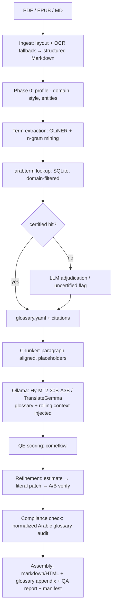

# Book-Harness — Brainstorming Notes

> Analysis of the translation workflow idea from two perspectives: (1) the idea itself — accuracy, cited terms, glossary; (2) implementation — best approach and main directions.
> Companion to [main-idea.md](./main-idea.md).

---

# Perspective 1 — The idea itself: an accurate, citable book-translation workflow

## What's already strong

- **Glossary-first** is the right order. Professional localization does terminology *before* drafting, not after — the instinct matches industry practice (termbase → translation → QA).
- **Guarded refinement** (estimate → literal patch → A/B verify) is the correct safety model: the model never gets to rewrite a whole chunk, so errors are bounded and auditable.
- **Everything-on-disk + resumable** is the right constraint for a 100k+ word job.

## Gaps worth closing in Phase 1 (glossary)

**1. GLiNER finds *entities*, not *terms*.** GLiNER is excellent for zero-shot NER (people, orgs, locations), but book terminology is mostly multiword technical noun phrases ("reinforcement learning", "supply chain") that NER misses. Extend extraction to a 3-signal pipeline:
- GLiNER (entities + custom labels like `technical_term`, `method_name`)
- Noun-phrase / n-gram mining with rarity scoring (TF-IDF against a general corpus — rare phrases are term candidates)
- LLM adjudication pass that merges, dedupes, and classifies candidates (term vs. name vs. noise)

**2. Domain detection must come first.** "Cell", "field", "interest" translate differently by domain. Add a **Phase 0: book profiling** — classify the book/chapters into domains, then *filter the dictionary lookup by domain*. arabterm already supports this: it is organized as separate dictionaries (military, finance, linguistics, legal, aerospace…) with `dictionary` and `term` tables in SQLite, so a domain tag maps naturally to a dictionary whitelist.

**3. Make every glossary entry a *citation*, not a pair.** This is the differentiator. arabterm's schema gives everything needed for real citations: source dictionary name, Wikidata ID, archive.org scan URL, and printed page number. A glossary entry should look like:

```yaml
- term_en: "reinforcement learning"
  term_ar: "التعلم المعزز"
  source: "المعجم الموحد لمصطلحات اللسانيات"   # or KSAA dictionary
  wikidata: "Q114600110"
  page: 214                # printed page, resolvable via page_offset
  scan: "https://archive.org/details/.../page/n213/mode/1up"
  status: certified        # certified | llm_chosen | uncertified
  decided_by: auto|llm|human
  alternatives: ["التعلم التقوية"]
```

**4. Define a conflict-resolution policy before the LLM chooses.** When multiple dictionaries give different translations, don't let the model improvise a priority each time. Encode a deterministic priority (e.g., KSAA unified glossaries > Librairie du Liban > others), and only fall back to LLM choice when sources tie — and record *why* it chose.

**5. Define the uncertified-term policy.** Scientific books always contain terms no dictionary covers. Decide the fallback explicitly: transliteration, keep-English-in-parentheses, or LLM coinage flagged `uncertified` for human review. Without this policy the glossary silently degrades.

**6. Arabic morphology breaks naive enforcement.** Post-hoc "glossary enforced" checks fail on Arabic because of prefixes/suffixes (ال، و، ب، ات، ين…). Enforcement needs normalization (strip diacritics, unify alef/ya/ta-marbuta) + stem-aware matching (CAMeL Tools is the standard toolkit here), otherwise you get false "violations" and false "compliance".

**7. Add a glossary freeze point and a drift loop.** Freeze the glossary before translation starts (versioned artifact). After drafting, mine the draft for *new* recurring terms the extraction missed → append as `uncertified` → human confirms → re-run only affected chunks. One loop, not infinite.

## Gaps worth closing in Phase 2 (translation)

- **Chunk on structure, not character count.** 1200 chars will cut mid-sentence and mid-markdown. Chunk at paragraph boundaries with a char ceiling, keep sentence-level fallback, and store `(chapter, index, source_offset)` so reassembly and diffs are exact.
- **Protect non-translatable spans.** Numbers, citations, footnotes, URLs, code, math, cross-references → replace with placeholder tokens before the model sees the text, restore after. This is the single biggest quality lever for technical books.
- **Context strategy:** prior paragraph is good; add a *rolling chapter summary* (one paragraph, updated every N chunks) so the model knows what the chapter is arguing, not just what the last paragraph said.
- **Style profile.** Extract a style guide from 2–3 sample chapters (tone, person, terminology conventions) in Phase 0 and inject it — otherwise the book reads like 500 inconsistent essays.
- **Hy-MT2 can translate but can't judge.** `tencent/Hy-MT2-30B-A3B` is a dedicated MT model — it follows translation instructions (including an official **terminology template**: "`X` translates to `Y`" lines) but it is not built for MQM span-locating or A/B judging. Use a general instruct model (Qwen3.5-27B / gemma-4-26B-A4B) for stages 2a and 2c, and Hy-MT2 (or TranslateGemma) for stage 1 and 2b's candidate generation.
- **Quality estimation to budget refinement.** Run a reference-free QE model (e.g., Unbabel's cometkiwi) on every chunk; spend the expensive estimate/verify passes on the worst-scoring chunks first. This turns refinement from "always ×3 cost" into "targeted".
- **Cross-chunk consistency audit** at book level: same source term must map to one target form everywhere; report drift as a QA metric, not just per-chunk.

## Output extensions (where the idea gets bigger)

1. **Auto-generated glossary appendix** — every translated book ships with a back-matter glossary: term, chosen translation, source dictionary, page, Wikidata link. Nobody does this; it makes the "cited terms" promise visible in the final artifact.
2. **Bilingual side-by-side edition** (paragraph-aligned HTML) — cheap to produce since chunks are already aligned.
3. **QA report per chapter** — QE distribution, glossary compliance %, patch counts, uncertified terms.
4. **Provenance manifest** — per chunk: model, prompt version, glossary version, timestamps. Makes any chunk reproducible and re-runnable.
5. **TMX/translation-memory export** — the aligned pairs become a reusable corpus; across books this grows into an asset (and a fine-tuning dataset if ever needed).

---

# Perspective 2 — Implementation: best way to build it, and the main directions

## The four strategic directions

| Direction | Shape | Pros | Cons |
|---|---|---|---|
| **1. File-based CLI pipeline** | Python package, `ingest → glossary → translate → refine → assemble`, every stage writes artifacts | Matches the "everything in files" note; trivially resumable; easiest to test | No live UI |
| **2. Local service + web UI** | Ollama/vLLM servers + orchestrator + SSE streaming + review page | Nice UX, streaming progress | Most work; UI is a distraction early |
| **3. MCP-native** | Glossary lookup + translation steps exposed as MCP tools; any agent (Claude, Copilot) drives the workflow | Reusable beyond books; fits the "special MCP for arabterm" idea | Agent latency/cost; harder to make deterministic |
| **4. Hybrid (recommended)** | Core Python library + thin CLI now; MCP server later; UI last | Value first, surfaces added incrementally | Slight up-front discipline in layering |

The key insight: **the pipeline core should be a library with pure file I/O**, and CLI/MCP/UI are all thin shells over it. That's what makes resumability and testing easy.

## Recommended architecture



## Component choices (verified names)

| Role | Candidate | Notes |
|---|---|---|
| Translation | **tencent/Hy-MT2-30B-A3B** | MoE (~3B active), 33 languages incl. Arabic, Apache-2.0, official **terminology prompt template**, FP8 for vLLM; GGUF exists for the 1.8B/7B siblings — check community GGUF for the 30B-A3B before committing to Ollama |
| Translation (light) | **google/translategemma-4b/12b/27b-it** | Gemma3-based, 55 languages; note the Gemma license terms; community GGUFs exist |
| Refinement/verify | **Qwen/Qwen3.5-27B** or **google/gemma-4-26B-A4B-it** | General instruct model needed for MQM spans + A/B judging |
| NER/term spans | **urchade/gliner_multi-v2.1** (or gliner2 ecosystem) | Zero-shot, CPU-friendly, custom labels |
| Quality estimation | **Unbabel/wmt22-cometkiwi-da** | Reference-free QE; note CC-BY-NC license |
| Terminology DB | **arabterm.db** (SQLite) | `dictionary` + `term` tables; AR/EN/FR; Wikidata + archive.org provenance built in — query directly, no MCP strictly required |
| OCR fallback (scanned Arabic) | MohamedRashad/arabic-large-nougat, PaddleOCR arabic | Only if sources are scans |

## Artifact layout (this *is* the resumability design)

```text
runs/<book-id>/
  00_source/          original file + extracted markdown
  01_profile/         domain.json, style.md, entities.jsonl
  02_glossary/        candidates.jsonl, glossary.yaml (versioned), audit.md
  03_chunks/          chunk-0001.json (source, placeholders, hash)
  04_drafts/          chunk-0001.md + .meta.json (model, prompt, glossary ver)
  05_refine/          chunk-0001.spans.json, patches.jsonl, verdicts.jsonl
  06_qa/              qe-scores.jsonl, compliance.jsonl
  07_output/          book.md / book.html, glossary-appendix.md, manifest.json
  state.json          stage cursor for resume
```

Cache key per chunk = `hash(source_chunk + glossary_version + model + prompt_version)` — change any input, only affected chunks re-run.

## Engineering details that decide success or failure

1. **Placeholder protection** for markdown structure, links, math, numbers, citations — translate *around* them, never through them.
2. **Arabic text normalization module** used by both enforcement and compliance (diacritics, alef forms, ta marbuta) — shared by extraction and QA.
3. **Determinism**: fixed seeds/temperature where possible; cache keyed on content, not position.
4. **Model bake-off first**: before committing, translate the same 30–50 sampled chunks with Hy-MT2-7B, Hy-MT2-30B-A3B, TranslateGemma-12b, Qwen3.5-27B; score with COMET + a glossary-compliance metric. Pick empirically, not by reputation.
5. **License hygiene**: Hy-MT2 (Apache-2.0) is safe; TranslateGemma has Gemma license terms; Tower/COMET-QE variants are CC-BY-NC — fine for personal use, not for a product.

## Phased roadmap

- **M1 — MVP (idea validation):** markdown in → GLiNER + arabterm glossary with citations → Ollama translation with glossary injection → markdown out. No refinement yet.
- **M2 — Accuracy:** refinement loop (estimate/patch/verify) + QE-budgeted scheduling + deterministic compliance audit.
- **M3 — Artifacts:** glossary appendix, bilingual HTML, QA report, provenance manifest, resume-from-any-stage.
- **M3.5 — MCP server** wrapping glossary lookup + chunk translation (the arabterm-MCP idea, generalized).
- **M4 — Web UI** with SSE streaming and a human-review screen for `uncertified` terms and low-QE chunks.

## Main risks

- **30B-A3B availability in Ollama** — verify GGUF support early; fallback is llama.cpp/vLLM or the 7B model.
- **Enforcement false positives** from Arabic morphology — budget real time for the normalizer.
- **QE model license** (NC) if this ever goes commercial — have an LLM-judge fallback.
- **Scope creep in the UI** — keep M4 last; the files-first core is what makes everything else possible.

---

## One-sentence take

The idea is sound and the guarded-refinement design is genuinely good; the two highest-leverage additions are (a) making glossary entries *cited artifacts* with dictionary/page/Wikidata provenance and an explicit uncertified-term policy, and (b) splitting roles so a dedicated MT model translates while a general instruct model does the judging.
